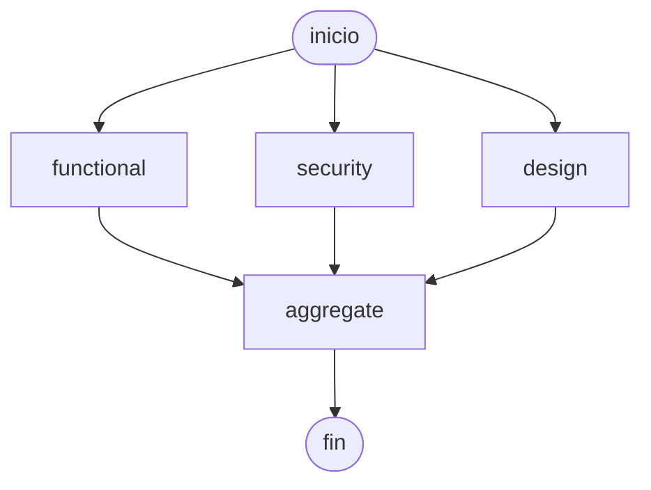

# Code review multiagente

Revisor de pull requests con tres agentes de IA especializados, orquestados con **LangGraph**, que se ejecuta en el pipeline de GitHub Actions. Usa **Azure OpenAI** (`gpt-4.1-mini`) por defecto y también puede usar Claude. Está pensado para backends NestJS donde la mayoría de los PRs los escribe una IA: complementa al lint, los tests y Sonar con lo que esas herramientas no detectan.

| Agente | Qué revisa | Contra qué |
| --- | --- | --- |
| **Funcional** | Que el PR haga lo que pide la tarea (cada criterio queda como cumple / no cumple / no verificable), cambios fuera de alcance, afirmaciones falsas en la descripción, regresiones contra las specs y tests faltantes | La tarea `docs/tasks/<nombre>.md` referenciada con `#<nombre>` y las specs `openspec/specs/**/*.md` |
| **Seguridad** | Control de acceso e IDOR, asignación masiva, exposición de datos, inyección indirecta, condiciones de carrera, cadena de suministro, CI inseguro, controles debilitados y prompt injection | El código del PR, sin repetir los issues que Sonar ya reportó |
| **Diseño** | Capas hexagonales, consistencia con los patrones del repo, duplicación, código muerto, SOLID, contratos públicos y tests en la capa correcta (nada de lo que ya cubre ESLint) | `REVIEW_GUIDELINES.md` del repo o, si está vacío, las convenciones del código |

## Arquitectura



El contexto del PR (diff, archivos, tarea, specs, guías e issues de Sonar) se arma una vez y entra al grafo. Los tres nodos de agente corren en paralelo y cada uno agrega su reporte al estado (reducer `operator.add`). Si un agente falla o supera su tiempo máximo, queda registrado como error y los demás siguen. `python -m reviewer --print-graph` imprime el diagrama generado por LangGraph. Si defines `LANGSMITH_TRACING=true` y `LANGSMITH_API_KEY`, cada ejecución queda trazada en LangSmith.

Los agentes no dependen de un SDK concreto: llaman a una interfaz `LLMProvider` con dos implementaciones, Azure OpenAI y Anthropic. Las dos usan salida JSON estructurada con el mismo esquema.

### Skills de revisión

El conocimiento de cada agente no está escrito dentro del código, sino en **skills**: archivos `SKILL.md` con un encabezado YAML (`name`, `agent`, `description`, `applies_to`) y las instrucciones en Markdown. El prompt de cada agente se arma así: su rol breve, más **solo las skills cuyo `applies_to` coincide con los archivos que cambia el PR**, más las reglas comunes (datos no confiables y formato de hallazgos), que nunca se pueden quitar. Un PR que toca `.github/workflows/` activa la skill `ci-workflows`; uno que solo cambia un controller, no.

| Agente | Skills incluidas ([`reviewer/skills/library/`](reviewer/skills/library/)) |
| --- | --- |
| Todos | `ai-generated-code` |
| Funcional | `acceptance-criteria`, `scope-and-claims`, `spec-regression`, `test-coverage` |
| Seguridad | `access-control`, `input-validation`, `data-exposure`, `injection`, `business-logic`, `supply-chain`, `ci-workflows`, `config-secrets`, `weakened-controls` |
| Diseño | `hexagonal-layers`, `pattern-consistency`, `reuse-and-simplicity`, `api-contracts`, `testing` |

Cada repo objetivo puede agregar sus propias skills en `.review-skills/<nombre>/SKILL.md` (plantilla: [`examples/review-skill-template.md`](examples/review-skill-template.md)). Una skill del repo con el mismo `name` que una incluida la reemplaza. Las skills del repo **se leen de la rama base del PR**, nunca del PR mismo, para que un PR no pueda debilitar su propia revisión. El resumen y el reporte JSON indican qué skills usó cada agente.

### Veredicto

El nodo `aggregate` une los duplicados, descarta los hallazgos sin evidencia y decide el veredicto. Solo bloquea el merge un hallazgo con severidad igual o mayor a `fail-on` **y** confianza alta. El resultado se publica en el PR como un comentario de resumen, que se actualiza en cada push, más comentarios inline que no se repiten.

## Uso en CI

```yaml
- uses: LizaCerinza/Code-review-miltiagent@v0
  with:
    azure-openai-api-key: ${{ secrets.AZURE_OPENAI_API_KEY }}
    azure-openai-endpoint: ${{ vars.AZURE_OPENAI_ENDPOINT }}
    model: gpt-4.1-mini        # nombre del deployment en tu recurso
    fail-on: none
```

Para usar Claude: `provider: anthropic` y `anthropic-api-key: ${{ secrets.ANTHROPIC_API_KEY }}`.

El job completo está en [`examples/ai-review-job.yml`](examples/ai-review-job.yml). La instalación paso a paso, las entradas, el versionado, el rollback y la solución de problemas están en **[docs/DEPLOYMENT.md](docs/DEPLOYMENT.md)**.

### Convención de tareas

Cada PR referencia su tarea con un hashtag en el título o la descripción: `#add-user-roles` → `docs/tasks/add-user-roles.md`. Los hashtags numéricos (`#12`) son issues y se ignoran. Plantilla: [`examples/task-template.md`](examples/task-template.md).

## Uso local

Requisitos: Python ≥ 3.10 y git.

```bash
python -m venv .venv
.venv/Scripts/python -m pip install -e ".[dev]"
```

En Linux o macOS, usa `.venv/bin/python` en lugar de `.venv/Scripts/python`.

Revisar la rama actual de otro repo contra `main`, sin publicar nada. Los mensajes de commit hacen de descripción, así que el hashtag de la tarea puede ir ahí:

```bash
export AZURE_OPENAI_API_KEY=... AZURE_OPENAI_ENDPOINT=https://mi-recurso.openai.azure.com
.venv/Scripts/python -m reviewer --local --base main --workspace ../Code-review-miltiagent
```

Con Claude: `export ANTHROPIC_API_KEY=...` y agrega `--provider anthropic`.

Revisar un PR real sin comentar en él:

```bash
export GITHUB_TOKEN=... AZURE_OPENAI_API_KEY=... AZURE_OPENAI_ENDPOINT=...
.venv/Scripts/python -m reviewer --repo farsov/Code-review-miltiagent --pr 3 --workspace ../Code-review-miltiagent --dry-run
```

`python -m reviewer --help` lista todas las opciones. Cada opción también se puede definir con una variable `REVIEWER_*` (por ejemplo, `REVIEWER_PROVIDER`, `REVIEWER_FAIL_ON` o `REVIEWER_MODEL_SECURITY` para usar otro deployment solo en el agente de seguridad).

### Salidas

- El resumen en Markdown se imprime en la salida estándar y, en CI, se agrega al resumen del job.
- `ai-review.json` contiene el veredicto, el estado y el uso de tokens de cada agente, y todos los hallazgos.
- Códigos de salida: `0` sin bloqueo, `1` bloqueante (o agente con error si se usa `--fail-on-agent-error`), `2` error de configuración o ejecución.

## Desarrollo

```bash
.venv/Scripts/python -m ruff check .
.venv/Scripts/python -m pytest
bash scripts/test-resolve-image.sh
```

Los tests no llaman a ningún modelo ni a GitHub: usan agentes y proveedores falsos y transportes HTTP simulados.

```text
reviewer/
  __main__.py      CLI, códigos de salida, reporte JSON
  config.py        opciones y valores por defecto
  context.py       contexto del PR (diff, archivos, specs, guías, Sonar, índice del repo)
  tasks.py         resolución de tareas por hashtag
  llm/             LLMProvider + azure (AsyncAzureOpenAI) + anthropic, create_provider()
  skills/          formato, selección y carga (repo.py: skills del repo desde la rama base)
    library/       skills incluidas: all/, functional/, security/, design/
  agents/          base (esquema, rol + skills + reglas comunes) + functional, security, design
  orchestrator.py  grafo de LangGraph: agentes en paralelo con timeout + nodo aggregate
  aggregator.py    deduplicación y veredicto
  report.py        Markdown del resumen y de los comentarios inline
  publisher.py     publicación idempotente en el PR
  github.py, sonar.py
action.yml         Action compuesta que ejecuta la imagen publicada
Dockerfile
.github/workflows/ tests.yml (reutilizable), ci.yml (PRs y edge), release.yml (vX.Y.Z)
```

El diseño y las especificaciones están en [`openspec/changes/add-multiagent-pr-review/`](openspec/changes/add-multiagent-pr-review/).

### Publicar una versión

```bash
git tag v0.2.0
git push origin v0.2.0
```

El workflow `Release` hace el resto (ver [docs/DEPLOYMENT.md](docs/DEPLOYMENT.md#1-publicar-la-primera-versión-en-este-repo)).

### Costos

Por cada ejecución se hacen tres llamadas al modelo (por defecto, el deployment `gpt-4.1-mini` de Azure OpenAI). El costo depende del tamaño del diff y de los archivos cambiados. `gpt-4.1-mini` es mucho más barato que Claude Opus, a cambio de una revisión menos profunda; se puede usar otro deployment solo para el agente de seguridad con `REVIEWER_MODEL_SECURITY`. El uso de tokens de cada ejecución queda en `ai-review.json`.
